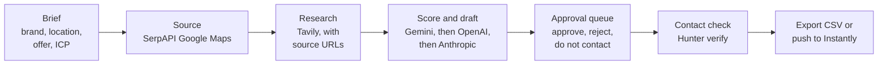

# Local Hospitality Lead Engine

AI-assisted lead research for local hospitality outreach, with a human approval step before anything leaves the app.

Give it a brand, a location and an offer. It finds and researches local businesses, ranks them against your ideal customer profile, drafts a personalised email for each, and puts every lead into an approval queue. Only leads a person approves can be exported or handed to an outreach tool.

> **Status:** working prototype (April to June 2026). It runs fully offline in seed mode. Live mode works with your own API keys; it has not been used for a real campaign.

---

## How it works



- **Three modes.** `seed_demo` needs no keys. `live_if_available` calls the real APIs and falls back step by step if a key is missing or a call fails. `cached_demo` replays a saved run instantly.
- **Model fallback chain.** Scoring and drafting try Gemini 2.5 Flash first, then OpenAI, then Anthropic, then a deterministic template, so a run never crashes because one provider is down.
- **Approval workflow.** Leads move through `generated`, `reviewed`, `approved`, `rejected`, `do_not_contact` and `exported`. Emails can be edited before approval.
- **Guards before outreach.** Rejected and do-not-contact leads can never be exported or pushed. Addresses that fail Hunter verification are blocked, and a manually entered address needs explicit confirmation before it can be pushed.
- **Provenance.** Research keeps its source URLs, and demo data is labelled as demo.

The app itself never sends email.

---

## Run it

```bash
python -m venv .venv
# Windows: .venv\Scripts\activate    macOS/Linux: source .venv/bin/activate
pip install -r requirements.txt
python app.py
```

Open http://127.0.0.1:5000 and pick **seed demo** mode. The approval queue is at `/approvals`.

### Live mode (optional)

Copy `.env.example` to `.env` and add any keys you have. Each is optional; whatever is missing falls back.

| Key | Used for |
|---|---|
| `SERPAPI_API_KEY` | Finding local businesses (Google Maps results) |
| `TAVILY_API_KEY` | Researching each business, with source URLs |
| `GEMINI_API_KEY` | Primary model for scoring and drafting |
| `OPENAI_API_KEY`, `ANTHROPIC_API_KEY` | Fallback models |
| `HUNTER_API_KEY` | Finding and verifying contact emails |
| `INSTANTLY_API_KEY` plus `INSTANTLY_CAMPAIGN_ID` or `INSTANTLY_LIST_ID` | Pushing approved, verified leads to an Instantly campaign or list |

Live runs are capped at 5 leads by default to control cost.

---

## Tests

```bash
pip install pytest
pytest -q
```

48 tests cover the approval workflow and export rules, live-mode fallbacks, output quality and progress reporting. They run in seed mode with no API keys, and run in CI on every push.

---

## Tech stack

Python, Flask, SQLite, vanilla JavaScript, Tailwind (CDN). Integrations: SerpAPI, Tavily, Gemini, OpenAI, Anthropic, Hunter and Instantly.

## How it was built

Designed by me and built with AI coding agents. I set the requirements and the approval rules, directed the agents, reviewed the output and defined the acceptance tests.
